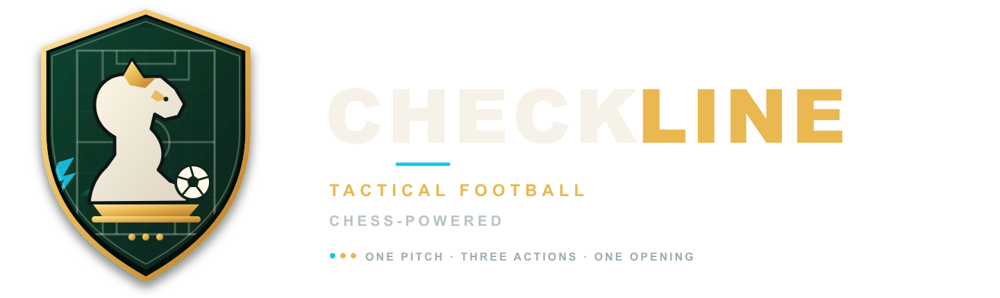

<p align="center">
  
</p>

<div align="center">

# CHECKLINE

### ⚽ Football meets chess.


**One pitch. Three actions. Outthink the defense.**

Checkline is tactical football on an **8 × 12 chessboard pitch**. Move your pieces, open a passing lane, unleash **Surge**, and score before the clock runs out.

<br>


-3ECF8E?style=for-the-badge&logo=supabase&logoColor=white)

**🤖 Play the AI** &nbsp; · &nbsp; **👥 Challenge a friend** &nbsp; · &nbsp; **🌐 Compete online** &nbsp; · &nbsp; **🪙 Build your look**

<br>

[✨ The game](#the-game) &nbsp;·&nbsp;
[🚀 Quick start](#quick-start) &nbsp;·&nbsp;
[🎮 Modes](#game-modes) &nbsp;·&nbsp;
[📖 Rules](#the-rules) &nbsp;·&nbsp;
[🕹️ Controls](#controls) &nbsp;·&nbsp;
[🏅 Ranks](#c-ranks) &nbsp;·&nbsp;
[🛍️ Shop](#coins--shop) &nbsp;·&nbsp;
[☁️ Online setup](#online-setup) &nbsp;·&nbsp;
[🧰 Project map](#project-map)

</div>

---

<a id="the-game"></a>
## ✨ The game

This is a match of **position, timing, and nerve**. Every turn gives you **3 Action Points**. Do you dribble through the gap, pass to a teammate, take the shot—or save an action to stop the counterattack?

- ♟️ **Chess-inspired tactics** — familiar piece shapes with short, football-sized movement.
- ⚽ **Real decisions** — mark receivers, block shooting lanes, press the carrier, and protect your keeper.
- 🎬 **Big-match energy** — floodlit pitch, original vector pieces, animated plays, goal celebrations, and synthesized sound.
- 🌍 **English + العربية** — fully localized interface with Arabic right-to-left layout.
- ♿ **Comfort built in** — keyboard controls, phone-friendly action bar, and reduced-motion support.

> 🏆 **First to 3 goals wins.** If time runs out, the match clock decides.

---

<a id="quick-start"></a>
## 🚀 Quick start

**Requires [Node.js 22 or newer](https://nodejs.org/).**

```bash
npm install
npm start
```

Open **[http://localhost:5173](http://localhost:5173)** and kick off! ⚽

```bash
npm test          # Rules, AI, localization, ranks, economy, and online-client tests (64)
npm run typecheck
```

> ✅ Local, computer, and tutorial play need no Supabase setup. Online play and the leaderboard are optional.

The project has no runtime npm dependencies; npm installs TypeScript and Node.js type definitions for building the game.

---

<a id="game-modes"></a>
## 🎮 Game modes

| Mode | What’s waiting for you |
| --- | --- |
| 🤖 **Computer** | Play Easy, Medium, or Hard. Choose Ivory, Ebony, or a random side. |
| 👥 **Local match** | Two players, one device, and a hand-off screen between turns. |
| 🌐 **Online match** | Public lobbies, private invite codes, live moves, reconnect and resume, online/away status, resign, and claim-win after 90 seconds away. |
| 🏅 **Leaderboard** | Player rank, C-tier, Elo, wins, draws, and losses. Browse 15 players per page. |
| 🎓 **Tutorial** | Seven interactive lessons teach movement, dribbling, passing, tackling, shooting, Surge, and defense. |
| 🔐 **Accounts** | Sign up, log in, change or reset your password, and sign out. Guest play is also available. |

Online turns are enforced by the server. Your own turn lasts **25 seconds**; the away claim becomes available after **90 seconds**.

---

<a id="the-rules"></a>
## 📖 The rules

### ⏱️ Your turn: 3 AP

A move, pass, shot, or tackle costs **1 Action Point (AP)**. Once per rally, each side can trigger **Surge** for **+1 AP** on a turn. Surge recharges at kickoff.

### ♟️ Your players

| Piece | Movement |
| --- | --- |
| 👑 **King / goalkeeper** | 1 square; stays in its own box. |
| 👸 **Queen** | Up to 2 squares in any line or diagonal. |
| 🏰 **Rook** | Up to 3 squares along a row or column. |
| 🔺 **Bishop** | Up to 3 squares diagonally. |
| 🐴 **Knight** | Jumps in an L shape. |
| 🛡️ **Pawn** | 1 square forward or sideways. |

Sliding pieces cannot move through another piece.

### ⚽ With the ball

- **Dribble** — the carrier moves just **1 square at a time**. A Knight still jumps.
- **Pass** — travel in a straight line, up to **4 squares**, through a clear lane. A teammate with an opponent directly beside them is **marked** and cannot receive.
- **Shoot** — fire in a straight line, up to **5 squares**, into an **open goal-mouth square (B–G on the end row)**. The keeper covers its square and every neighboring square.
- **Tackle** — move onto the carrier. Pawns tackle diagonally forward. Only the carrier can be tackled; a tackled player is benched until the next kickoff.
- **Score** — carry the ball into an open goal square, or tackle a keeper holding the ball in its own goal mouth.

### 🏁 The match clock

First to **3 goals** takes the match. After **30 turns**, the leader wins. A tie goes to **golden goal**; if the match is still level at turn **40**, it is a draw.

Each playable turn has a separate **25-second clock** in local, computer, and online games. The clock pauses during hand-offs, goal and kickoff screens, animations, and the computer’s turn. It does not reset after each action; at zero, the turn ends automatically. Tutorial lessons have no turn clock.

See **[DECISIONS.md](DECISIONS.md)** for the thinking behind the rules.

---

<a id="controls"></a>
## 🕹️ Controls

### 🧭 Board signals

| Signal | Meaning |
| --- | --- |
| • Dots | Legal moves |
| 🔴 Red ring | Tackle |
| ✨ Gold glow | Scoring move |
| × Faint cross | Blocked square—hover or click to learn why |
| ⊘ Mark | Teammate is marked and cannot receive a pass |
| 🟥 Red dashed lines | Shots your opponent could take next turn |

Select the ball carrier, then click a gold-ringed teammate to pass or a glowing goal square to shoot. The dashed gold line previews the shot.

### ⌨️ Keyboard

| Key | Action |
| --- | --- |
| `S` | Surge |
| `E` | End turn |
| `U` / `Ctrl+Z` | Undo within your turn in local, computer, and tutorial games |
| `Tab` | Focus the board |
| `↑` `↓` `←` `→` | Move the board cursor |
| `Enter` / `Space` | Act |
| `Esc` | Deselect |

### 📱 Phones & small tablets

**Undo / Resign** and **End turn** stay in a fixed bar at the bottom of the screen. Turn your phone sideways and the bar floats in the bottom-right corner—no scrolling to reach your next move.

### ⚙️ Settings

Change the language from the menu or side panel; your choice is remembered. Sound is synthesized in the browser, so no audio files are needed. The game also respects your operating system’s reduce-motion setting.

---

<a id="c-ranks"></a>
## 🏅 C-ranks

Climb the ladder one smart result at a time:

| Tier | Rank points |
| --- | ---: |
| 🟤 **C5** | 0–149 |
| ⚪ **C4** | 150–299 |
| 🟡 **C3** | 300–449 |
| 🔵 **C2** | 450–599 |
| 🟣 **C1** | 600+ |

- ✅ **Win:** +10 points
- ➖ **Loss:** −6 points
- 🛡️ Rank points never fall below 0.

Rank points change only in eligible online matches between two email accounts. An early resign or forfeit before turn 6 earns no win points. Only the first **3 wins per day against the same opponent** earn points.

Your tier, points, and progress appear on your lobby profile card; the leaderboard also shows each player’s tier. Online match Elo is tracked alongside wins, draws, and losses.

---

<a id="coins--shop"></a>
## 🪙 Coins & shop

Your coins, purchases, and equipped items follow your account across devices. Without an account, your coins stay in this browser; computer matches can earn coins too.

### 💰 Earn coins

| How | Reward |
| --- | ---: |
| Win an online match | **+3 coins** |
| Every 3rd finished online match | **+5 coins** |
| Play without an account | Coins are saved in this browser; computer matches can also pay out. |

The game owner can securely grant or remove coins with an audited admin function. See **[SUPABASE_SETUP.md](SUPABASE_SETUP.md)**.

### 🎨 Make it yours

| Collection | Items |
| --- | --- |
| 🏟️ **7 pitch floors** | Midnight Pitch (10), Sunset Arena (15), Neon Cyber (20), Aurora Night (35), Synthwave Grid (45), Deep Space (60), Prism Holo (80) |
| ♟️ **3 piece skins** | Obsidian Dark (10), Neon Glow (15), Gold Elite (25) |
| ⚽ **5 balls** | Ember (12), Frost (15), Neon Ball (18), Cosmic (30), Golden Ball (35) |

### 🎁 Full-set bundles

| Bundle | Price | You save |
| --- | ---: | ---: |
| 🌃 Neon Nights | 55 | 23 |
| 🌌 Cosmic Voyage | 70 | 30 |
| 🏆 Champion’s Gold | 99 | 41 |

Mix and match categories, preview every item live in the shop, and pay only for the missing pieces of a bundle—never more than its set price. Shop items are **100% cosmetic** and never affect the rules. Animations stop when Reduce Motion is on.

---

<a id="online-setup"></a>
## ☁️ Online setup

Online play and the leaderboard use **your own Supabase project**.

1. Follow **[SUPABASE_SETUP.md](SUPABASE_SETUP.md)** to create and configure a project.
2. Run `supabase/setup.sql` in the Supabase SQL Editor.
3. Copy `.env.example` to `.env`.
4. Add `SUPABASE_URL` and `SUPABASE_ANON_KEY` to `.env`.
5. Run `npm start` and open the game.

🔒 Use only the public anon or publishable key. Never put a service-role or secret key in browser configuration, and never commit your `.env` file.

---

<a id="project-map"></a>
## 🧰 Project map

```text
src/rules/      Rules engine and board / AP / movement / clock configuration
src/ai/         Easy / Medium / Hard computer opponent
src/i18n/       English, Arabic, RTL, and translated rule messages
src/online/     Supabase client, online config, C-ranks, match sync
src/tutorial/   Lesson positions and success checks
src/ui/         App, board, views, vector pieces, motion, sound, economy, styles
supabase/       Database setup, upgrades, admin queries, verification fixtures
scripts/        Local server, browser config, SQL verification, upgrade checks
tests/          Rules, AI, localization, ranks, economy, online, and browser tests
```

### 🧪 Optional developer checks

- `npm run verify:sql` checks the server rules against the TypeScript rules action by action, plus security, C-ranks, coins, purchases, and admin grants. It also upgrades legacy database versions and checks that no player, coin, or item is lost. Requires PostgreSQL 15+ tools: `initdb`, `pg_ctl`, and `psql`.
- `npm run e2e` checks every screen in both languages, full matches, all tutorial lessons, online flows against a fake backend, and leaderboard states. Requires Playwright with Chromium and a running `npm start`.

---

<a id="project-notes"></a>
## 📝 Project notes

- **[DECISIONS.md](DECISIONS.md)** — game design, rule changes, and balance data.
- **[SUPABASE_SETUP.md](SUPABASE_SETUP.md)** — online setup, account help, and secure coin administration.
- **[LICENSE](LICENSE)** — proprietary software license.
- **[NOTICE](NOTICE)** — third-party component notices.

---

<div align="center">

### 🥅 One pitch. Three actions. One opening.

**Think like a chess player. Finish like a striker.** ⚽

© 2026 Mohammed Khalid · **Checkline is proprietary software.**  
The code, rules, designs, artwork, and text may not be copied, modified, distributed, or hosted without written permission. See [LICENSE](LICENSE).

</div>
